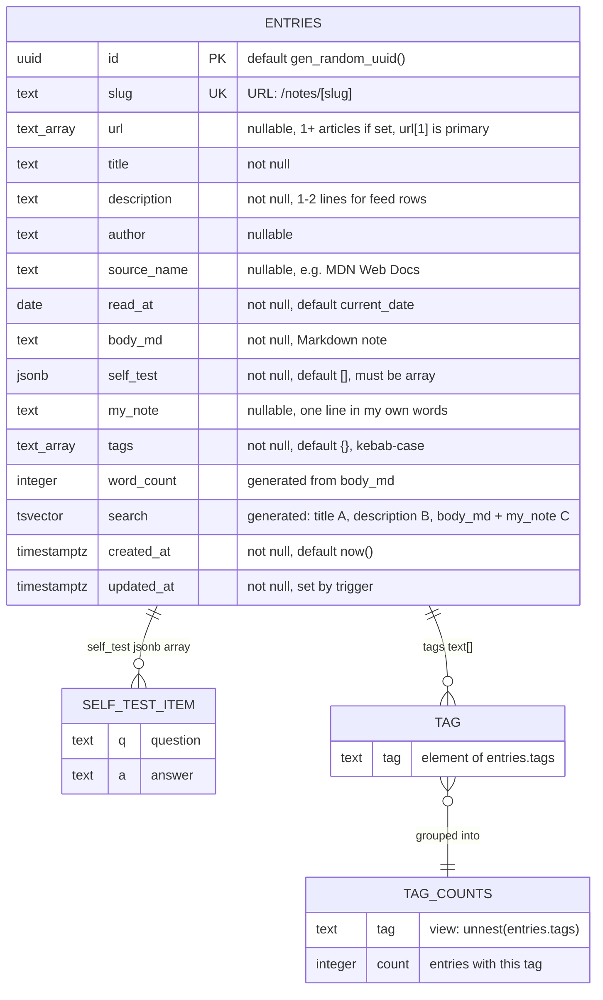

# Entity Relationship Diagram

Source of truth: [`supabase/migrations/0001_init.sql`](../supabase/migrations/0001_init.sql).

The database has one physical table, `entries`. Tags and self-test questions are
stored inline (`text[]` and `jsonb`) rather than in their own tables. They appear
below as logical entities so the shape of the data is visible. `tag_counts` is a
view derived from `entries.tags`.

## Notes

| Object | Kind | Details |
| --- | --- | --- |
| `entries` | table | `url` is null or holds at least one link (never empty). RLS on. Single policy `public read` (SELECT for everyone). No insert/update/delete policies, so writes go through `service_role` only. |
| `entries_search_idx` | GIN index | On `search`, for full-text search. |
| `entries_tags_idx` | GIN index | On `tags`, for tag filters. |
| `entries_url_idx` | GIN index | On `url`, for "already noted this link?" lookups (`url @> array[...]`). |
| `entries_read_at_idx` | B-tree index | On `read_at desc`, for the feed order. |
| `entries_updated_at` | trigger | `BEFORE UPDATE`, calls `set_updated_at()` to refresh `updated_at`. |
| `tag_counts` | view | `security_invoker = true`. Ordered by `count desc, tag asc`. |

The app reads `entries` in two shapes (`src/lib/entries.ts`):

- `EntrySummary`: `slug, title, description, read_at, tags, word_count` for the feed.
- `Entry`: every column except `search` for a note page.
